<div align="center">



# 🛵 SKYLINE FOLIO


**A cinematic, scroll-driven portfolio experience — one endless ride through a hand-built low-poly city,**
from a sunrise cloud-dive to a midnight arrival at the tower.

[](https://your-username.github.io/skyline-portfolio/)
[](https://threejs.org)
[](https://gsap.com)
[](#-quick-start)
[](LICENSE)

</div>


## ✦ What is this?

**Skyline Folio** turns a portfolio into a journey. There is no "page" — there is a **road**.
Press _Start the Ride_ and you free-fall through a cloud deck, touch down on a boulevard,
chase a scooter through a procedurally-built pastel city while the sun arcs overhead,
browse projects on glowing billboards, and land at a midnight plaza where the tower is waiting.

Everything you see and hear is **generated in the browser** — the buildings, the clouds, the engine hum. No stock assets, no build step, no backend. One repo, double-click, ride.

> 🏆 Built in the tradition of award-winning cinematic portfolios — as an open template you can make your own in minutes.


## 🎬 The Experience

| Chapter              | What happens                                                                 |
| -------------------- | ---------------------------------------------------------------------------- |
| ⏳ **Loader**        | Terminal-style `000 → 100` counter, live status words, sound & desktop hints |
| 🪂 **The Descent**   | Free-fall from 200m, pierce the cloud deck, FOV kicks as you drop            |
| 🛵 **The Ride**      | Chase-cam behind a scooter — scarf physics, wheel spin, lane sway, dust      |
| 🏙 **The Terrace**   | Camera cranes over the rooftops while the skills panel floats in             |
| 🖼 **Billboard Row** | Four projects, each with a living in-world billboard + detail card           |
| 🌇 **Golden Hour**   | Full day → dusk → night cycle, windows ignite, lamps buzz on                 |
| 🗼 **The Tower**     | Arrival at the plaza, beacon lit, contact CTA, marquee footer                |

<details>
<summary>🎧 <b>Sound design (100% synthesized)</b></summary>
<br/>

No audio files. The whole soundscape is generated with the **Web Audio API**:

- 🛵 **Engine** — detuned sawtooth pair through a lowpass; RPM follows your scroll speed
- 💨 **Wind** — filtered noise that roars during the dive and whispers at speed
- 🎹 **Pad** — a five-voice chord with slow LFO drift that swells at golden hour
- 🔇 Sound toggle with animated EQ bars — your choice is remembered

</details>

<details>
<summary>🖱 <b>Custom cursor</b></summary>
<br/>

- Coral dot + lagging difference-blend ring that **stretches along your movement**
- Grows over interactive elements, carries contextual labels (`View`, `Menu`, `Go`…)
- Reacts to scroll velocity — automatically disabled on touch devices

</details>


## 🧰 Tech Stack

```
🌍 Three.js r160        → the 3D world (vendored, module build)
🎞 GSAP 3               → menu / loader / micro-motion
🔊 Web Audio API        → procedural engine, wind & pad
🎨 Canvas 2D            → every texture painted at runtime
🔤 Unbounded + Space Grotesk → self-hosted, zero external calls
🚫 Build tools          → none. plain HTML • CSS • JS modules
```


## 🚀 Quick Start

It's a static site. There is **nothing to install**.

```bash
# clone it
git clone https://github.Muhammad112233/Portfolio-Template-36.git
cd skyline-portfolio

# serve it (any static server works — modules need http://)
python3 -m http.server 8000
# or: npx serve .
```

Open **http://localhost:8000** → press **Start the Ride** → scroll. 🛵💨

> ⚠️ ES modules don't run from `file://` — always use a local server or GitHub Pages.


## ✍️ Make It Yours (60 seconds)

Everything text-y lives in **one file**: [`js/content.js`](js/content.js)

```js
export const SITE = {
  shortTitle: 'Your Name',              // ← hero + brand
  role: 'Creative Web Engineer',        // ← your title
  email: 'you@domain.com',              // ← contact button
  ...
};
```

| Want to change…                                | Where                                  |
| ---------------------------------------------- | -------------------------------------- |
| 👤 Name, role, email, tagline, availability    | `SITE` in `js/content.js`              |
| 📖 The 5 story chapters                        | `CHAPTERS` in `js/content.js`          |
| 🛠 Skills grid                                 | `SKILLS` in `js/content.js`            |
| 🖼 Projects (name, blurb, stack, accent color) | `WORKS` in `js/content.js`             |
| 🔗 Social links & menu entries                 | `LINKS` / `MENU` in `js/content.js`    |
| 🎥 Camera shots (angles, heights, FOV)         | `KEYS` in `js/webgl/scene.js`          |
| 🌈 Sky / time-of-day palette                   | `SKY_TIMELINE` in `js/webgl/sky.js`    |
| 🏙 City density & palette                      | `PALETTE` + loop in `js/webgl/city.js` |


## 📁 Project Structure

```
skyline-portfolio/
├── index.html              ← shell: canvas + overlay layers
├── favicon.svg
├── css/
│   └── style.css           ← every DOM visual (design tokens at top)
├── js/
│   ├── content.js          ← ⭐ all your content lives here
│   ├── main.js             ← boot, loader, start gate, hero
│   ├── core/
│   │   ├── audio.js        ← procedural Web Audio soundscape
│   │   ├── cursor.js       ← custom cursor
│   │   └── ui.js           ← menu, chapters, HUD, cookie, footer
│   └── webgl/
│       ├── scene.js        ← renderer + camera cinematography (KEYS)
│       ├── sky.js          ← day→night palette, clouds, stars, moon
│       ├── city.js         ← procedural boulevard, billboards, tower
│       ├── rider.js        ← the scooter hero (scarf physics!)
│       ├── particles.js    ← birds, dust, speed streaks
│       └── textures.js     ← runtime-painted canvas textures
├── vendor/                 ← three.module.js + gsap.min.js (local)
├── fonts/                  ← Unbounded + Space Grotesk (woff2)
└── assets/                 ← og-cover + README banners
```


## ⚡ Performance & Accessibility

- 🎯 Adaptive quality — DPR scales down if FPS drops below 42
- 📱 Fully responsive — touch scroll, wider mobile FOV, layout reflows
- ♿ Honors `prefers-reduced-motion`, semantic landmarks, keyboard-friendly menu (`Esc` closes)
- 🔦 Zero-shadow strategy: blob shadows + emissive tricks = console-game look at phone-grade cost
- 📦 ~1.6 MB total weight, **zero external requests**


## 🙏 Credits & License

- 🏙 3D engine: [Three.js](https://threejs.org) (MIT) · Motion: [GSAP](https://gsap.com) (Standard license, free for this use)
- 🔤 Fonts: [Unbounded](https://fonts.google.com/specimen/Unbounded) & [Space Grotesk](https://fonts.google.com/specimen/Space+Grotesk) (OFL)
- 💡 Concept homage: the scroll-driven 3D-journey portfolio genre (Bruno Simon, Sébastien Lempens et al.) — every line of code, texture, 3D asset and word here is original
- 📜 Template released under the **MIT License** — take it, ride it, ship it. A star ⭐ is the toll booth.

<div align="center">
<br/>

**Built with ☕ and an unreasonable love of scroll-driven cameras.**


</div>

<div align="center">

## 🌟 Support the Project

If you find this template useful, please consider giving it a star! It helps others discover the repository and supports future development.

</div>


